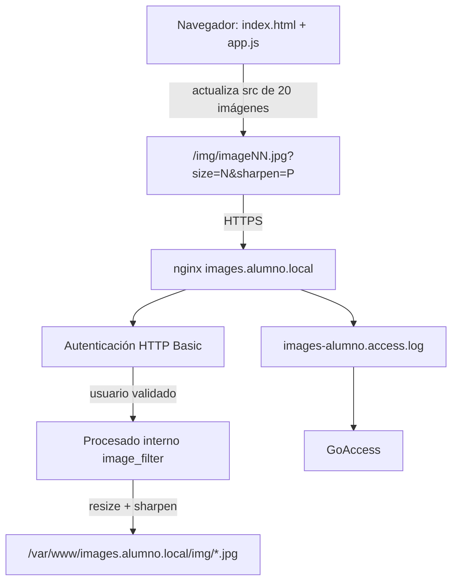

# AE3 — Galería con procesado de imágenes, módulos y HTTPS

## Preparación del entorno

La práctica se realiza utilizando el contenedor `dpl-lab`.

Dentro del contenedor se instalaron las herramientas necesarias:

```bash
apt-get update
apt-get install -y libnginx-mod-http-image-filter imagemagick goaccess apache2-utils
```

Se comprobó la disponibilidad del módulo de procesado de imágenes mediante:

```bash
nginx -V 2>&1 | grep image_filter
```

El paquete instala el módulo dinámico de `image_filter`, que nginx carga desde su configuración de módulos.

También se verificó la configuración general con:

```bash
nginx -t
```

## Certificado HTTPS

Para servir la galería mediante HTTPS se generó un certificado autofirmado con OpenSSL.

Los archivos utilizados por nginx se encuentran dentro del contenedor:

```text
/etc/ssl/dpl/images.alumno.local.crt
/etc/ssl/dpl/images.alumno.local.key
```

El certificado incluye SAN para:

- `images.alumno.local`
- `www.images.alumno.local`

La clave privada no forma parte del repositorio. Únicamente se incluye una copia del certificado público en `certs/`.

## Generación de las imágenes de prueba

La galería utiliza 20 imágenes cuadradas llamadas `image01.jpg` hasta `image20.jpg`.

Las imágenes se generan dentro del contenedor `dpl-lab` y se almacenan fuera del repositorio, en:

```text
/var/www/images.alumno.local/img/
```

Primero se crea la carpeta:

```bash
mkdir -p /var/www/images.alumno.local/img
```

Las 20 imágenes se generan con ImageMagick mediante:

```bash
for i in $(seq -w 1 20); do
  convert -size 600x600 plasma:fractal \
    -quality 90 \
    /var/www/images.alumno.local/img/image${i}.jpg
done
```

Se comprobó el número de imágenes generadas mediante:

```bash
ls /var/www/images.alumno.local/img/image*.jpg | wc -l
```

y sus dimensiones con:

```bash
identify /var/www/images.alumno.local/img/image01.jpg
```

Las imágenes no se versionan porque son contenido de prueba generado automáticamente. En la entrega solo se conserva el comando necesario para reproducirlas.

## Configuración de nginx

El sitio utiliza `images.alumno.local` como nombre principal.

Se definieron listas blancas mediante `map` para controlar los valores recibidos en los parámetros `size` y `sharpen`. Si el cliente envía un valor no permitido se utiliza el valor por defecto.

El sitio HTTP redirige mediante código 301 a HTTPS y `www.images.alumno.local` redirige al nombre principal.

La galería se sirve desde:

```text
/var/www/images.alumno.local
```

El procesado mediante `image_filter` se aplica únicamente dentro de `location /img/`.

Las imágenes están protegidas mediante autenticación HTTP básica. El fichero de usuarios se encuentra fuera del DocumentRoot:

```text
/etc/nginx/images-users
```

Se utilizan logs propios para el sitio:

```text
/var/log/nginx/images-alumno.access.log
/var/log/nginx/images-alumno.error.log
```
## Aplicación web

La aplicación está formada por los archivos:

```text
web/index.html
web/app.js
web/estilos.css
```

La galería muestra 20 imágenes, desde `image01.jpg` hasta `image20.jpg`.

El formulario permite modificar:

- tamaño de la imagen;
- ancho del borde;
- color del borde;
- enfoque;
- desenfoque.

Al pulsar el botón Generar, JavaScript modifica el `src` de las 20 imágenes para enviar a nginx los parámetros de tamaño y enfoque.

Los efectos de borde, color y desenfoque se aplican desde el navegador.

## Reparto de responsabilidades entre servidor y cliente

El tamaño y el enfoque son procesados en el servidor mediante el módulo `image_filter` de nginx.

Los parámetros se envían mediante la URL:

```text
/img/imageNN.jpg?size=N&sharpen=P
```

Los valores permitidos se controlan mediante directivas `map`. Si se recibe un tamaño o enfoque no incluido en la lista blanca, nginx utiliza el valor configurado por defecto.

El borde, el color del borde y el desenfoque se aplican en el cliente mediante CSS y JavaScript.

`image_filter` permite realizar operaciones de procesado como redimensionado y enfoque, pero no permite aplicar directamente los efectos de presentación utilizados para el borde y el desenfoque de esta práctica.

Durante las pruebas fue necesario separar la autenticación del procesado de la imagen. `/img/` realiza la autenticación y, una vez validado el usuario, la petición pasa internamente al `location` encargado de utilizar `image_filter`.

## Comprobaciones realizadas

Se comprobó primero la configuración de nginx:

```bash
docker exec dpl-lab nginx -t
```

El resultado fue correcto:

```text
syntax is ok
test is successful
```

La página principal mediante HTTPS devuelve:

```text
HTTP/1.1 200 OK
```

Una petición a una imagen sin credenciales devuelve:

```text
HTTP/1.1 401 Unauthorized
WWW-Authenticate: Basic realm="Galeria protegida"
```

Al utilizar las credenciales de práctica se obtiene:

```text
HTTP 200
```

Se comprobó el procesado con una imagen solicitada a tamaño 150:

```bash
docker exec dpl-lab identify /tmp/ae3.jpg
```

Resultado:

```text
150x150
```

También se probó un tamaño no permitido (`size=999`). Al no estar incluido en la lista blanca, nginx utilizó el valor por defecto:

```text
300x300
```

Las redirecciones HTTP y `www.images.alumno.local` devolvieron:

```text
HTTP/1.1 301 Moved Permanently
Location: https://images.alumno.local/
```

Las salidas completas de estas pruebas se encuentran en `comprobaciones.txt`.

## Monitorización con GoAccess

El sitio utiliza un log propio:

```text
/var/log/nginx/images-alumno.access.log
```

El informe se generó con:

```bash
goaccess /var/log/nginx/images-alumno.access.log \
  --log-format=COMBINED \
  -o /tmp/ae3.json
```

El fichero JSON generado contiene las peticiones realizadas durante las comprobaciones de la galería.

## Problemas encontrados

### Nginx no estaba escuchando en HTTPS

Durante una de las primeras comprobaciones se ejecutó una petición a:

```text
https://localhost/
```

y `curl` devolvió un error indicando que no podía conectarse al puerto 443.

La configuración pasaba correctamente `nginx -t` y contenía `listen 443 ssl`, por lo que se comprobaron los procesos del contenedor:

```bash
docker exec dpl-lab ps aux | grep '[n]ginx'
```

No había ningún proceso de nginx en ejecución.

Se solucionó iniciándolo dentro del contenedor:

```bash
docker exec dpl-lab nginx
```

Después de iniciarlo, HTTPS comenzó a responder correctamente.

### Error 415 al acceder a una imagen sin autenticarse

Inicialmente el mismo `location /img/` contenía tanto:

```text
auth_basic
```

como:

```text
image_filter
```

Al solicitar una imagen sin credenciales se esperaba:

```text
401 Unauthorized
```

pero nginx devolvía:

```text
415 Unsupported Media Type
```

Se probaron primero distintas formas de gestionar el error mediante `error_page`, pero el resultado seguía siendo 415.

Finalmente se separó la autenticación del procesado.

El `location /img/` comprueba las credenciales y, cuando son correctas, realiza una petición interna al `location` encargado del procesado con `image_filter`.

Después de este cambio, una petición sin credenciales devuelve correctamente:

```text
401 Unauthorized
```

y una petición autenticada continúa permitiendo redimensionar y aplicar enfoque a las imágenes.

## Diagrama de funcionamiento



## Repositorio remoto

El microproyecto está disponible en:

https://github.com/mariaizdo05/dpl-ae3
